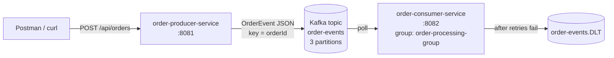

# Spring Boot + Kafka Order Microservices

A learning project: two **independent** Spring Boot microservices that communicate **asynchronously** through Apache Kafka.

- **order-producer-service** (port 8081): accepts orders over REST, validates them and publishes an `OrderEvent` to the `order-events` topic.
- **order-consumer-service** (port 8082): listens to `order-events` and processes each order. Retries failures and sends poison messages to a dead-letter topic.

The two services never call each other. The only thing they share is the **JSON format** of the event and the **topic name**.



## Contents

1. [Technology stack](#technology-stack)
2. [Prerequisites](#prerequisites)
3. [Project structure](#project-structure)
4. [Quick start (everything in Docker)](#quick-start-everything-in-docker)
5. [Running locally from IntelliJ](#running-locally-from-intellij)
6. [API examples](#api-examples)
7. [How it works](#how-it-works)
8. [Kafka concepts](#kafka-concepts)
9. [Docker concepts and commands](#docker-concepts-and-commands)
10. [Testing](#testing)
11. [Debugging in IntelliJ](#debugging-in-intellij)
12. [Reliability: retries, acks, DLT, idempotency](#reliability)
13. [Common issues](#common-issues)

## Technology stack

| Area | Choice |
|------|--------|
| Language | Java 21 |
| Framework | Spring Boot 3.5.6 (Web, Validation, Actuator) |
| Messaging | Spring for Apache Kafka 3.3, Apache Kafka 3.9.1 in KRaft mode (no ZooKeeper) |
| Build | Maven |
| Containers | Docker, Docker Compose, multi-stage builds (`maven:3.9-eclipse-temurin-21` → `eclipse-temurin:21-jre-alpine`) |
| Tests | JUnit 5, Mockito, AssertJ, MockMvc, Testcontainers |

## Prerequisites

- JDK 21
- Maven 3.9+ (or let IntelliJ use its bundled Maven)
- Docker Desktop (running)
- Optional: Postman, IntelliJ IDEA

## Project structure

```text
.
├── order-producer-service/
│   ├── src/main/java/com/example/orderproducer/
│   │   ├── OrderProducerApplication.java
│   │   ├── config/KafkaProducerConfig.java        # declares the order-events topic
│   │   ├── controller/OrderController.java        # POST /api/orders
│   │   ├── dto/OrderRequest.java                  # REST input + validation rules
│   │   ├── dto/OrderResponse.java                 # REST output
│   │   ├── event/OrderEvent.java                  # Kafka message (the contract)
│   │   ├── exception/GlobalExceptionHandler.java  # 400 / 503 error responses
│   │   ├── exception/OrderPublishingException.java
│   │   └── service/OrderProducerService.java      # KafkaTemplate.send + ack handling
│   ├── src/main/resources/application.yml
│   ├── src/test/...                               # service + controller tests
│   ├── Dockerfile, .dockerignore, pom.xml
├── order-consumer-service/
│   ├── src/main/java/com/example/orderconsumer/
│   │   ├── OrderConsumerApplication.java
│   │   ├── config/KafkaConsumerConfig.java        # retries + dead-letter topic
│   │   ├── consumer/OrderConsumer.java            # @KafkaListener
│   │   ├── event/OrderEvent.java                  # consumer's OWN copy of the contract
│   │   └── service/OrderProcessingService.java    # business logic + idempotency
│   │       InvalidOrderException.java
│   ├── src/main/resources/application.yml
│   ├── src/test/...                               # unit tests + Testcontainers integration test
│   ├── Dockerfile, .dockerignore, pom.xml
├── docker-compose.yml
├── .env.example
└── pom.xml        # aggregator only, so IntelliJ opens both services. The services do not inherit from it.
```

## Quick start (everything in Docker)

```bash
docker compose up --build -d     # build both images (Maven runs inside Docker) and start all 3 containers
docker compose ps                # wait until all three show "(healthy)"
curl -X POST http://localhost:8081/api/orders -H "Content-Type: application/json" \
     -d '{"orderId":"ORD-101","productName":"Laptop","quantity":2,"price":799.99}'
docker compose logs -f order-consumer
```

Stop the stack:

| Command | Effect |
|---|---|
| `docker compose stop` | Stops containers. Everything is kept. Restart with `docker compose start`. |
| `docker compose down` | Removes containers and network. **The `kafka-data` volume, and every message in it, is kept.** |
| `docker compose down -v` | Also deletes the volume, which wipes all Kafka data. |

## Running locally from IntelliJ

1. Start **only Kafka**:
   ```bash
   docker compose up -d kafka
   ```
2. Open the root folder in IntelliJ. It imports both Maven projects through the root `pom.xml`.
3. Run `OrderProducerApplication`, then `OrderConsumerApplication` (green ▶ next to `main`).

No configuration is needed. Both `application.yml` files default to `localhost:29092`:

```yaml
bootstrap-servers: ${KAFKA_BOOTSTRAP_SERVERS:localhost:29092}
```

In Docker Compose, the environment variable `KAFKA_BOOTSTRAP_SERVERS=kafka:9092` overrides that default. One config file serves both environments; only an environment variable changes. You could use Spring profiles (`application-docker.yml`) instead, but an environment variable is simpler and is the usual approach for containers.

### `localhost` vs Docker service names

- Inside a container, `localhost` means **that container itself**. The producer container cannot reach Kafka at `localhost:9092`.
- Containers on the same Compose network find each other by **service name**. Docker runs a DNS server that resolves `kafka` to the Kafka container's IP.
- Your Windows host is outside that network, so it uses `localhost:29092`, which is the port Docker publishes.

Kafka adds one complication: the client connects once, and the broker then replies with the address to use from then on (the *advertised listener*). That's why Kafka has two listeners:

| Listener | Port | Advertised as | Used by |
|---|---|---|---|
| INTERNAL | 9092 | `kafka:9092` | containers |
| EXTERNAL | 29092 | `localhost:29092` | IntelliJ / host apps |
| CONTROLLER | 9093 | (not advertised) | KRaft controller traffic |

## API examples

`POST http://localhost:8081/api/orders` with header `Content-Type: application/json`. Every response below was captured from the running stack.

**1. Valid order** → `202 Accepted`
```json
{"orderId":"ORD-101","productName":"Laptop","quantity":2,"price":799.99}
```
```json
{"orderId":"ORD-101","status":"ACCEPTED","topic":"order-events","partition":0,"offset":0}
```
Consumer log:
```
OrderConsumer          : Received order event key=ORD-101 partition=0 offset=0
OrderProcessingService : Processing order ORD-101: 2 x Laptop @ 799.99 = total 1599.98
OrderProcessingService : Order ORD-101 processed successfully
```

**2. Missing orderId** → `400 Bad Request`. Nothing is sent to Kafka.
```json
{"productName":"Laptop","quantity":2,"price":799.99}
```
```json
{"type":"about:blank","title":"Invalid order request","status":400,"detail":"Request validation failed",
 "instance":"/api/orders","errors":{"orderId":"orderId must not be blank"}}
```

**3. Negative quantity** → `400`, with `"errors":{"quantity":"quantity must be greater than zero"}`

**4. Invalid price**: `-5` or `0` → `400`, with `"errors":{"price":"price must be greater than zero"}`. `"abc"` → `400 "Malformed request"`.

**5. Multiple consecutive orders** (ORD-201, ORD-202, ORD-203) → three `202` responses:
```
{"orderId":"ORD-201",...,"partition":1,"offset":0}
{"orderId":"ORD-202",...,"partition":1,"offset":1}
{"orderId":"ORD-203",...,"partition":2,"offset":0}
```
The key's hash chooses the partition. Each partition has its own offset counter.

**6. Kafka down** (`docker compose stop kafka`) → `503 Service Unavailable` after about 8 seconds:
```json
{"title":"Messaging system unavailable","status":503,"detail":"Order could not be published. Please retry later."}
```

### Choosing HTTP status codes

| Code | Meaning | Used here? |
|---|---|---|
| 200 OK | Request done, result in the body | No. Nothing was completed synchronously. |
| 201 Created | A resource now exists at a URL (usually with a `Location` header) | No. There's no `GET /api/orders/{id}`. |
| **202 Accepted** | Accepted for **later** processing | **Yes.** Kafka has the event, and the consumer processes it later. |
| **400 Bad Request** | The client sent invalid data. Retrying the same request won't help. | **Yes.** Validation or malformed JSON. |
| **503 Service Unavailable** | A temporary server-side problem. A retry may succeed. | **Yes.** Kafka didn't acknowledge the event. |

## How it works

### Producer, step by step
1. **`OrderController.createOrder`**: Jackson turns the JSON into an `OrderRequest`. Because of `@Valid`, Spring checks `@NotBlank`/`@Positive` **before** the method runs. If validation fails, `GlobalExceptionHandler` returns a 400.
2. `OrderEvent.from(request)` maps the API object to the Kafka message and adds `eventId` and `createdAt`.
3. **`OrderProducerService.publish`** calls `kafkaTemplate.send(topic, orderId, event)`.
   - `send` is **asynchronous**. It returns a `CompletableFuture` right away, and the record goes into an in-memory batch buffer.
   - `whenComplete(...)` logs the result when the broker answers.
   - `future.get(10s)` blocks until the broker **acknowledges** the record. With `acks=all`, the message counts as published only when the future completes successfully. At that point every in-sync replica has written it.
   - On a failure or timeout, it throws `OrderPublishingException`, which the handler turns into a **503**. The client never gets a false "success".
4. The controller returns **202** with the partition and offset where Kafka stored the event.

**Why block?** Blocking gives an honest answer, which matters for a REST API. In very high-throughput systems you'd return `CompletableFuture<ResponseEntity>` from the controller, so Tomcat threads aren't held while waiting. The guarantee is the same, but the code is harder to follow.

**JSON without type headers.** By default, Spring's `JsonSerializer` adds a `__TypeId__` header containing the producer's Java class name (`com.example.orderproducer.event.OrderEvent`). The consumer doesn't have that class. We set `spring.json.add.type.headers: false`, and the consumer sets `spring.json.use.type.headers: false` plus `spring.json.value.default.type`. The **JSON field names** are the only contract.

### Consumer, step by step
1. At startup, Spring finds `@KafkaListener` on `OrderConsumer.onOrderEvent` and creates a **listener container**. This is a background thread (`ntainer#0-0-C-1` in the logs) that runs `consumer.poll()` in a loop.
2. Kafka assigns partitions of `order-events` to the `order-processing-group` group.
3. For each record, `ErrorHandlingDeserializer` → `JsonDeserializer` converts the bytes into the consumer's own `OrderEvent`.
4. The container calls `onOrderEvent(record)`, which delegates to `OrderProcessingService.process`.
5. When the method returns normally, the container **commits the offset**, so the group will not receive that record again.
6. When it throws, the `DefaultErrorHandler` takes over (see [Reliability](#reliability)).

### Class responsibilities

| Class | Responsibility | Key annotations |
|---|---|---|
| `OrderProducerApplication` | Boots Spring. Component scanning finds the other classes. | `@SpringBootApplication` |
| `OrderController` | HTTP → domain. Doesn't know about Kafka. | `@RestController`, `@RequestMapping`, `@PostMapping`, `@Valid`, `@RequestBody` |
| `OrderRequest` | REST input contract + validation rules | `@NotBlank`, `@NotNull`, `@Positive` |
| `OrderEvent` (producer) | Kafka message contract | - |
| `OrderProducerService` | Sends to Kafka and turns the ack/failure into a result or exception | `@Service`, `@Value` |
| `KafkaProducerConfig` | Declares the topic (`NewTopic` bean → `KafkaAdmin` creates it) | `@Configuration`, `@Bean` |
| `GlobalExceptionHandler` | Exceptions → `ProblemDetail` JSON (400/503) | `@RestControllerAdvice`, `@ExceptionHandler` |
| `OrderConsumer` | Kafka → domain. The messaging equivalent of a controller. | `@Component`, `@KafkaListener` |
| `OrderProcessingService` | Business rules, idempotency, logging | `@Service` |
| `KafkaConsumerConfig` | Retry policy, dead-letter topic and DLT publisher | `@Configuration`, `@Bean` |

**Dependency injection.** Each class receives its collaborators through its **constructor**, e.g. `OrderController(OrderProducerService service)`. When Spring creates the beans, it sees the constructor parameter, finds the matching bean and passes it in. You never write `new OrderProducerService(...)` in production code. Tests can, and they pass in a mock.

## Kafka concepts

- **Kafka** is a distributed, durable, append-only **log**. Producers append messages, and consumers read them at their own pace. Unlike a classic queue, reading a message doesn't delete it.
- **Why microservices use it:** it **decouples** services. The producer doesn't need the consumer to be up, doesn't know how many consumers exist, and isn't slowed down by them. New consumers (billing, analytics...) can be added later without changing the producer.
- **Producer / consumer:** the client that writes, and the client that reads.
- **Topic:** a named stream of messages (`order-events`).
- **Partition:** a topic is split into partitions (3 here). Each partition is an ordered log, stored and read independently, which is how Kafka scales.
- **Key:** `orderId`. Kafka computes `hash(key) % partitions`, so **the same key always goes to the same partition**.
- **Ordering:** guaranteed **only within a partition**. All events for `ORD-101` stay in order. Events for different orders may be processed in any relative order.
- **Consumer group:** consumers with the same `group.id` **share** the partitions, and each partition goes to exactly one member. Run 3 consumer instances and each gets one partition. A 4th instance would sit idle. A *different* group gets its own full copy of every message.
- **Offset:** a message's position in its partition (0, 1, 2...). The group commits "I've processed up to offset N" to Kafka (`__consumer_offsets`).
- **Retention:** messages are kept for 7 days here (`KAFKA_LOG_RETENTION_HOURS: 168`), **whether or not they were consumed**. They are deleted when that time runs out.
- **Consumer offline?** Messages pile up in the topic. When the consumer restarts, it continues from its last committed offset and catches up. Nothing is lost, as long as it comes back within the retention period. `auto-offset-reset: earliest` only matters the very first time a group starts and has no committed offset.
- **Many messages from the producer?** They're spread across partitions by key, batched for efficiency, and consumed in order within each partition.
- **KRaft:** Kafka now manages its own metadata with a built-in Raft "controller" quorum, so ZooKeeper is no longer needed. Our single container acts as both `broker` and `controller`.

## Docker concepts and commands

- **Image:** a read-only template (filesystem + startup command). **Container:** a running instance of an image. One image can run as many containers.
- **Dockerfile:** the recipe for building an image.
- **Multi-stage build:** stage 1 (`maven:...-21`, about 500 MB) compiles the jar. Stage 2 (`eclipse-temurin:21-jre-alpine`, about 200 MB) copies **only the jar** in. Maven, sources and the JDK don't end up in the final image. Copying `pom.xml` first and running `dependency:go-offline` creates a cached layer, so dependencies are downloaded again only when the pom changes.
- **Network:** `kafka-net` is a bridge network with built-in DNS (service name → IP).
- **Volume:** `kafka-data` stores Kafka's log files outside the container, so they survive `down` and re-creation.
- **Port mapping** `"8081:8081"` means `host:container`.
- **Health checks:** Kafka is "healthy" only when `kafka-broker-api-versions.sh` gets an answer. The services use `/actuator/health`. `depends_on: condition: service_healthy` makes the apps wait until **Kafka actually works**, not just until its container has started.
- **Environment variables** configure each container (`KAFKA_BOOTSTRAP_SERVERS`...). `docker compose` also reads a `.env` file (see `.env.example`) for `${VAR:-default}` values.

```bash
docker compose up --build -d          # (re)build images, start everything in the background
docker compose ps                     # status + health
docker compose logs -f                # follow all logs (Ctrl+C stops following, not the containers)
docker compose logs -f order-producer
docker compose logs -f order-consumer
docker compose down                   # remove containers + network, KEEP Kafka data
```

Look inside Kafka:
```bash
docker exec -it kafka /opt/kafka/bin/kafka-topics.sh --bootstrap-server localhost:9092 --describe --topic order-events
docker exec -it kafka /opt/kafka/bin/kafka-console-consumer.sh --bootstrap-server localhost:9092 --topic order-events --from-beginning --property print.key=true
docker exec -it kafka /opt/kafka/bin/kafka-consumer-groups.sh --bootstrap-server localhost:9092 --describe --group order-processing-group
```
The last command shows `CURRENT-OFFSET`, `LOG-END-OFFSET` and `LAG` (unprocessed messages) for each partition.

## Testing

```bash
cd order-producer-service && mvn test
cd order-consumer-service && mvn test
# or, from the root:  mvn verify
```

| Test | Type | What it proves |
|---|---|---|
| `OrderProducerServiceTest` | Mockito unit | Key = orderId. A failed or timed-out future → `OrderPublishingException` |
| `OrderControllerTest` | `@WebMvcTest` slice | 202 on success. 400 for missing id, negative quantity, zero price, non-numeric price. 503 on publishing failure |
| `OrderProcessingServiceTest` | Plain unit | Processing, duplicate skipping, validation |
| `OrderConsumerTest` | Mockito unit | Listener delegates and propagates failures to the error handler |
| `OrderConsumerIntegrationTest` | Testcontainers (real Kafka) | Plain JSON **without type headers** is consumed. A poison message goes to `order-events.DLT` |

The unit tests need no Kafka. The integration test starts its own Kafka container and is **skipped automatically if Docker isn't running**.

## Debugging in IntelliJ

1. `docker compose up -d kafka`
2. Start both applications with **Debug** (the bug icon) instead of Run.
3. Set breakpoints by clicking in the gutter:

| Where | What to inspect |
|---|---|
| `OrderController.createOrder`, first line | `request`: already parsed **and validated** |
| `OrderProducerService.publish`, the `kafkaTemplate.send` line | `event`, `topic`. Step over (F8) and see that `future` isn't done yet |
| Inside the `whenComplete` lambda | Runs on thread `kafka-producer-network-thread`. Inspect `result.getRecordMetadata()` for partition and offset |
| `OrderConsumer.onOrderEvent` | `record.key()`, `record.partition()`, `record.offset()`, `record.value()` |
| `OrderProcessingService.process` | `event`, `total` |

4. Send the valid order from Postman. Then follow these steps:
   1. **Request enters the controller.** Tomcat → `DispatcherServlet` → Jackson → validation → your breakpoint. Look at the **Frames** panel: the call stack shows all of these Spring layers.
   2. **Dependency injection.** In **Variables**, expand `this.orderProducerService`. Spring injected that instance at startup. Its `kafkaTemplate` was auto-configured from `application.yml`.
   3. **Send.** Press F7 to step into `publish`, then F8 over `send(...)`. The call returns at once. Postman is still waiting because `future.get` blocks.
   4. **Kafka stores it.** The broker appends the record to the partition chosen by `hash("ORD-101") % 3` and replies with the offset. Your `whenComplete` breakpoint fires on the producer I/O thread.
   5. **Consumer receives it.** In the *consumer* debug session, `onOrderEvent` stops on thread `org.springframework.kafka.KafkaListenerEndpointContainer#0-0-C-1`. Nothing called it directly: the container's poll loop found a new record and invoked your method by reflection.
   6. **Processing.** Press F7 into `process` and watch `total` being computed. Resume (F9). The method returns, and the container commits the offset.
   7. **Experiment:** stay paused in the consumer for more than 5 minutes (`max.poll.interval.ms`). Kafka decides the consumer is dead and rebalances. When you resume, the record will be delivered again. This is why consumers must handle duplicates.

Tips: right-click a breakpoint → *Condition* `event.orderId().equals("ORD-202")`. Use **Evaluate Expression** (Alt+F8) to run code while paused.

<a id="reliability"></a>
## Reliability: retries, acks, DLT, idempotency

### Producer side
- **`acks`**: `0` = don't wait (fast, can lose data). `1` = the leader has written it. **`all`** (used here) = all in-sync replicas have written it. With a single broker there's only one replica. In production, use 3 brokers, `replication.factor=3` and `min.insync.replicas=2`.
- **Retries + idempotence**: the client retries transient errors automatically. `enable.idempotence=true` gives each record a sequence number, so the broker drops duplicates caused by those retries.
- **Kafka unavailable**: `max.block.ms`/`delivery.timeout.ms` (5s/8s) make `send` fail quickly. The API returns 503 and the client can retry later. *Not* covered: if the broker accepts the write but the HTTP connection drops before the 202 is sent, the client might retry and publish a second event. The consumer's de-duplication handles this only if the event has the same id. A robust fix is a client-supplied idempotency key, or the **transactional outbox** pattern (write to a DB table in the same transaction, then relay it to Kafka).

### Consumer side
- **Acknowledgements / offset commits**: Spring's default `AckMode.BATCH` commits after the records returned by a poll have been processed. If the consumer crashes before committing, those records are delivered again. This is **at-least-once** delivery.
- **Retries**: `DefaultErrorHandler` with `FixedBackOff(1000ms, 2)` gives 1 original attempt + 2 retries. Retries happen **in place**, which blocks that partition for a few seconds (and keeps the ordering).
- **Dead-letter topic**: after the last retry, `DeadLetterPublishingRecoverer` writes the record to `order-events.DLT`, keeping the same partition and adding exception headers. Then the consumer moves on. Without a DLT, one bad message ("poison pill") would block the partition forever.
- **Non-retryable errors** go straight to the DLT: deserialization failures (bad JSON) and `InvalidOrderException`. Retrying bad data is pointless.
- **Duplicates & idempotent consumers**: at-least-once delivery means duplicates *will* happen (rebalances, crashes, producer retries above). `OrderProcessingService` skips `eventId`s it has seen already. That set is **in memory**, so it is lost on restart and not shared between instances. In production, store processed ids in a database with a unique constraint, in the same transaction as the business change.
- **Restarts**: the consumer resumes from its committed offset. A rebalance briefly pauses consumption while partitions are reassigned.
- **Ordering**: per key/partition only. Retries are blocking, so ordering holds. Non-blocking retry topics (`@RetryableTopic`) give more throughput but can reorder events.

Inspect the DLT:
```bash
docker exec -it kafka /opt/kafka/bin/kafka-console-consumer.sh --bootstrap-server localhost:9092 \
  --topic order-events.DLT --from-beginning --property print.key=true --property print.headers=true
```
Send a poison message by hand:
```bash
docker exec -it kafka /opt/kafka/bin/kafka-console-producer.sh --bootstrap-server localhost:9092 \
  --topic order-events --property parse.key=true --property key.separator=:
> BAD-1:this is not json
```

### What this project does and doesn't guarantee

| ✅ Provided | ❌ Not provided (next steps) |
|---|---|
| 202 is returned only after Kafka has acknowledged the event (`acks=all`) | Replication (single broker) |
| No duplicate writes from producer retries (idempotent producer) | Durable de-duplication across restarts (needs a DB) |
| At-least-once consumption with retries + DLT | Exactly-once end-to-end (needs transactions or idempotent DB writes) |
| Per-order ordering (key = orderId) | Atomic "save to DB + publish" (outbox pattern) |
| Poison messages don't block the partition | DLT reprocessing / alerting |

### Troubleshooting serialization errors
- `No type information in header and no default type provided` → the consumer is missing `spring.json.value.default.type`.
- `The class '...' is not in the trusted packages` → the producer is still sending `__TypeId__` headers, or `spring.json.trusted.packages` is wrong. Set `use.type.headers: false` on the consumer.
- `Cannot construct instance` / `Unrecognized field` → the JSON doesn't match the record. Compare the field names. `@JsonIgnoreProperties(ignoreUnknown = true)` tolerates new fields.
- In all of these cases the record ends up in `order-events.DLT`. Read it with `print.headers=true` to see the `kafka_dlt-exception-message` header.

## Common issues

| Symptom | Cause / fix |
|---|---|
| IntelliJ app logs `Connection to node -1 (localhost/127.0.0.1:29092) could not be established` | Kafka isn't running: `docker compose up -d kafka`. Or port 29092 is taken: change `KAFKA_EXTERNAL_PORT` in `.env`. |
| Container logs try `localhost:9092` | `KAFKA_BOOTSTRAP_SERVERS` isn't set. Inside Docker it must be `kafka:9092`. |
| `Port 8081 is already in use` | Another instance is running (in IntelliJ *and* Docker?). Stop one, or change the port. |
| 503 from the producer | Kafka is down or unhealthy. Check `docker compose ps` and `docker compose logs kafka`. |
| Consumer gets old messages on first start | Expected: `auto-offset-reset: earliest`. |
| Consumer doesn't get messages sent before it existed, using a new group id | Check `auto-offset-reset`. Also check that the topic name matches. |
| Testcontainers: `Could not find a valid Docker environment` | Docker Desktop isn't running. With Docker Engine 29+, Testcontainers ≥ 1.21.4 is required (set in the consumer pom). |
| Git Bash: `exec: "C:/Program Files/Git/opt/kafka/bin/..." no such file` | Git Bash rewrites Linux paths. Run `export MSYS_NO_PATHCONV=1` first, or use PowerShell. |
| Want a clean slate | `docker compose down -v` (deletes all Kafka data). |
